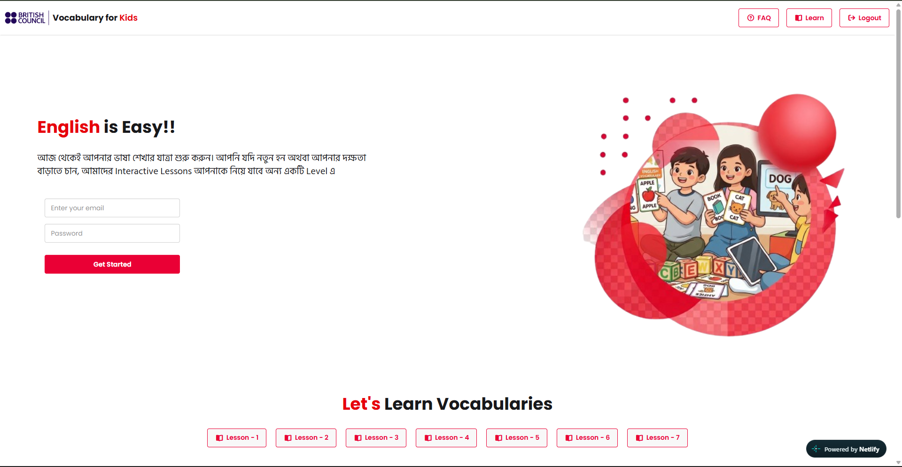
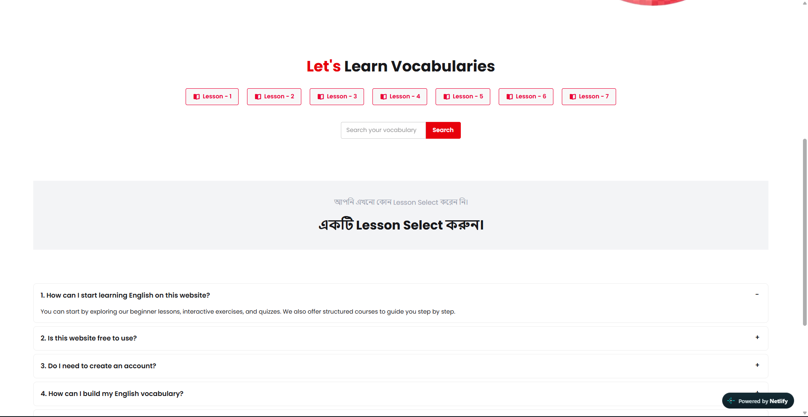
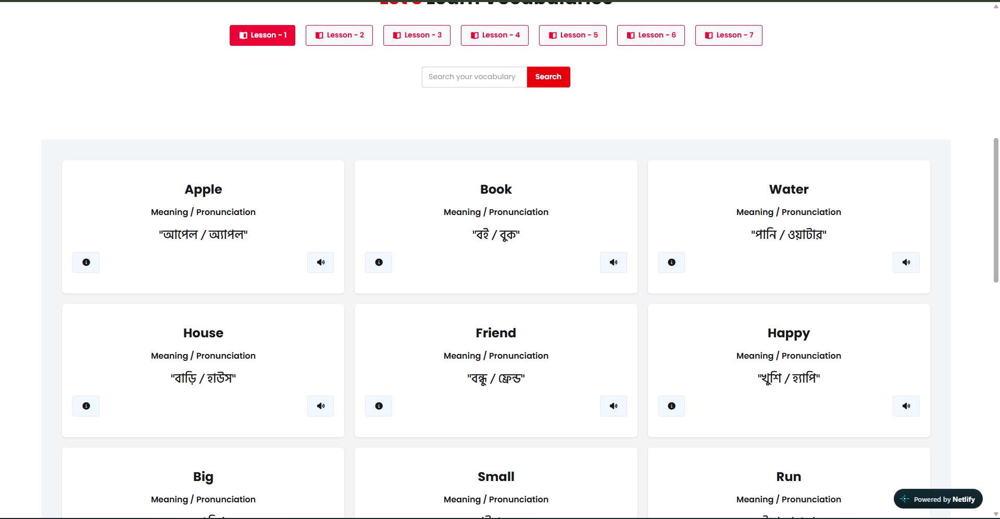
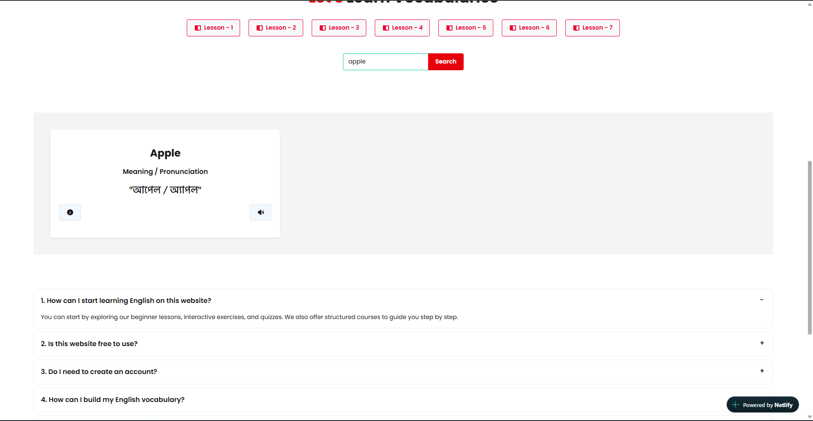

# English Vocabulary for Kids

An interactive, responsive web app that helps kids learn English vocabulary level by level. Learners pick a lesson, browse word cards with Bangla meanings and pronunciations, open a detailed view with example sentences and synonyms, search across the whole dictionary, and hear any word spoken aloud.

## Web application screenshot






[](https://shimmering-praline-35d74f.netlify.app)
[](https://github.com/Sf-Shohag71/English-vocabulary-for-kids)

**🔗 Live site:** https://shimmering-praline-35d74f.netlify.app
**💻 Source code:** https://github.com/Sf-Shohag71/English-vocabulary-for-kids

---

## Table of Contents

- [Overview](#overview)
- [Features](#features)
- [Tech Stack](#tech-stack)
- [Project Structure](#project-structure)
- [Getting Started](#getting-started)
- [API Reference](#api-reference)
- [How It Works](#how-it-works)
- [Error and Edge-Case Handling](#error-and-edge-case-handling)
- [Responsive Design](#responsive-design)
- [Accessibility Notes](#accessibility-notes)
- [Browser Support](#browser-support)
- [Challenges and Solutions](#challenges-and-solutions)
- [Future Scope](#future-scope)
- [Key Learnings](#key-learnings)
- [Author](#author)

---

## Overview

Many Bangla-speaking children find English vocabulary hard to practice with dry word lists. This project turns vocabulary learning into a lesson-based, card-driven experience:

1. Choose a **Lesson (level)**.
2. Browse **word cards** showing the English word, its Bangla meaning, and Bangla pronunciation.
3. Tap **details** for an example sentence and synonyms.
4. Tap the **speaker** to hear the word.
5. Or skip lessons and **search** any word directly.

The app is built with vanilla JavaScript and consumes a public REST API, so it needs no build step and no backend.

---

## Features

### Lessons

- Lesson buttons are **generated dynamically** from the API on page load.
- The **active lesson** is highlighted so the learner always knows where they are.

### Word Cards

- Each card shows the **word**, **meaning**, and **pronunciation**.
- Two action buttons per card: **details** (info icon) and **pronounce** (speaker icon).
- A friendly **"no vocabulary yet"** state with a prompt to move to the next lesson when a level is empty.
- A default prompt (in Bangla) is shown before any lesson is selected.

### Word Details Modal

- Opens from the info icon and loads data from the Word Detail API.
- Displays the word with pronunciation, meaning, example sentence, and synonyms (rendered as chips).

### Search

- Search across **all words** in the dictionary (case-insensitive, partial match).
- Searching **clears the active lesson highlight**, since results no longer belong to a single level.

### Pronunciation

- Uses the browser's built-in **Web Speech API** (`SpeechSynthesis`) to read words aloud, with no external audio files or keys.

### Loading and Invalid Data Handling

- A **loading spinner** appears while data is fetched.
- Missing or falsy values (`undefined`, `null`, empty strings) are replaced with readable fallback messages instead of being displayed raw.

### UI and UX

- Fully **responsive** layout (mobile-first with a collapsible menu).
- Bilingual interface: English content with Bangla guidance text.
- FAQ accordion, login/sign-up style hero form, and footer with contact links.

---

## Tech Stack

| Layer     | Technology                                                                                                                      |
| --------- | ------------------------------------------------------------------------------------------------------------------------------- |
| Markup    | HTML5                                                                                                                           |
| Styling   | [Tailwind CSS v4](https://tailwindcss.com/) (browser build) + [DaisyUI v5](https://daisyui.com/) + custom CSS                   |
| Scripting | Vanilla JavaScript (ES6+: `fetch`, `async/await`, template literals)                                                            |
| Icons     | [Font Awesome](https://fontawesome.com/)                                                                                        |
| Fonts     | [Poppins](https://fonts.google.com/specimen/Poppins), [Hind Siliguri](https://fonts.google.com/specimen/Hind+Siliguri) (Bangla) |
| Speech    | Web Speech API (`SpeechSynthesisUtterance`)                                                                                     |
| Data      | Programming Hero Open API (REST, JSON)                                                                                          |
| Hosting   | Netlify                                                                                                                         |

---

## Project Structure

```
English-vocabulary-for-kids/
├── index.html          # Page markup, modal, FAQ, footer
├── style.css           # Custom styles (fonts, red button theme, active state)
├── script/
│   └── index.js        # All app logic: fetching, rendering, search, speech
└── assets/             # Logos, hero illustration, empty-state image
```

---

## Getting Started

No build tools or package installation are required.

### Prerequisites

- A modern web browser
- An internet connection (the app loads its CSS libraries, fonts, icons, and API data from CDNs)

### Run locally

```bash
# 1. Clone the repository
git clone https://github.com/Sf-Shohag71/English-vocabulary-for-kids.git

# 2. Move into the project folder
cd English-vocabulary-for-kids

# 3. Open index.html in your browser
```

For a smoother experience, serve it with a simple local server:

```bash
# Using Python
python -m http.server 5500

# Or using VS Code's "Live Server" extension
```

Then visit `http://localhost:5500`.

### Deploy

The project is a static site and can be deployed to Netlify, Vercel, or GitHub Pages by pointing the host at the repository root. No build command or output directory is needed.

---

## API Reference

Base URL: `https://openapi.programming-hero.com/api`

| Purpose            | Method | Endpoint      | Example       |
| ------------------ | ------ | ------------- | ------------- |
| Get all levels     | `GET`  | `/levels/all` | `/levels/all` |
| Get words by level | `GET`  | `/level/{id}` | `/level/5`    |
| Get word details   | `GET`  | `/word/{id}`  | `/word/5`     |
| Get all words      | `GET`  | `/words/all`  | `/words/all`  |

### Sample response: word details

```json
{
  "id": 1,
  "level": 1,
  "word": "Apple",
  "meaning": "আপেল",
  "pronunciation": "অ্যাপল",
  "sentence": "She eats an apple every morning.",
  "points": 1,
  "partsOfSpeech": "noun",
  "synonyms": ["fruit"]
}
```

### Sample response: words in a level

```json
{
  "id": 11,
  "level": 1,
  "word": "Sun",
  "meaning": "সূর্য",
  "pronunciation": "সান"
}
```

---

## How It Works

### Application flow

```
Page load
   └─▶ loadLesson()  ──▶  GET /levels/all  ──▶  displayLesson()  ──▶  lesson buttons

Click lesson button
   └─▶ getLevelWord(id)
         ├─ manageSpinner(true)
         ├─ GET /level/{id}
         ├─ removeActive() → highlight clicked button
         └─ displayLevelWord() → word cards (or empty state) → manageSpinner(false)

Click "details"
   └─▶ loadWordDetails(id) ──▶ GET /word/{id} ──▶ displayWordDetails() ──▶ modal.showModal()

Click "speaker"
   └─▶ pronounceWord(word) ──▶ SpeechSynthesis

Click "Search"
   └─▶ removeActive() ──▶ GET /words/all ──▶ filter by input ──▶ displayLevelWord()
```

### Key functions (`script/index.js`)

| Function                   | Responsibility                                       |
| -------------------------- | ---------------------------------------------------- |
| `loadLesson()`             | Fetches all levels on page load                      |
| `displayLesson(lessons)`   | Builds the lesson buttons dynamically                |
| `getLevelWord(id)`         | Loads words for a level and toggles the active state |
| `displayLevelWord(words)`  | Renders word cards or the empty-state message        |
| `loadWordDetails(id)`      | Fetches full details for a single word               |
| `displayWordDetails(data)` | Fills and opens the details modal                    |
| `createElements(arr)`      | Converts a synonyms array into styled chips          |
| `pronounceWord(word)`      | Speaks a word using the Web Speech API               |
| `manageSpinner(status)`    | Shows or hides the loader and word container         |
| `removeActive()`           | Clears the active class from all lesson buttons      |

---

## Error and Edge-Case Handling

| Scenario                                   | Behavior                                                           |
| ------------------------------------------ | ------------------------------------------------------------------ |
| No lesson selected yet                     | Bangla prompt asks the user to select a lesson                     |
| Lesson has no words                        | Empty-state card with illustration and "go to next lesson" message |
| Word, meaning, or pronunciation is missing | Fallback text is shown instead of `undefined` / `null`             |
| Search has no matches                      | The same empty-state card is shown                                 |
| Data is loading                            | Spinner is shown and the word grid is hidden                       |

---

## Responsive Design

- **Mobile:** hamburger dropdown menu, stacked hero section, smaller headings.
- **Tablet/Desktop:** horizontal navigation with outlined buttons, side-by-side hero (text and illustration).
- The lesson buttons wrap and center on all screen sizes.

---

## Accessibility Notes

- Semantic landmarks (`header`, `section`, `footer`, `nav`) are used.
- The native `<dialog>` element powers the modal, which provides built-in focus handling and `Esc` to close.
- Images include `alt` attributes where applicable.

---

## Browser Support

| Browser       | Support                                   |
| ------------- | ----------------------------------------- |
| Chrome / Edge | ✅ Full                                   |
| Firefox       | ✅ Full                                   |
| Safari        | ✅ Full (voice availability varies by OS) |

> **Note:** Pronunciation quality and available voices depend on the voices installed in the user's browser/OS.

---

## Challenges and Solutions

Building a framework-free app that talks to several API endpoints surfaced some real engineering problems. These are the main ones and how they were approached.

### 1. Keeping the loader, active button, and content in sync

**Problem:** Fetching is asynchronous, so the spinner, the highlighted lesson button, and the word grid can easily get out of step. If the active class is applied before the data arrives, the UI shows a lesson as selected while the old content is still on screen.
**Solution:** A single `manageSpinner(status)` function controls loader and grid visibility, and the active state is only updated inside the `.then()` after a successful response. This keeps the highlight tied to content that has actually loaded.

### 2. Handling incomplete or inconsistent API data

**Problem:** Some words come back with missing `word`, `meaning`, or `pronunciation` values, which would render as `undefined` or `null` on the cards.
**Solution:** Every field is checked with a fallback (for example, a Bangla "not found" message), so the learner never sees raw falsy values. Empty levels and empty search results share one friendly empty-state design.

### 3. Rendering dynamic UI without a framework

**Problem:** Lesson buttons and word cards must be generated from JSON, and each needs its own behavior (details, pronunciation, level loading).
**Solution:** Template literals build the markup, and inline handlers pass the IDs needed by `getLevelWord(id)` and `loadWordDetails(id)`. Unique element IDs such as `lesson-btn-${level_no}` make it possible to target the correct button for the active state.

### 4. Search across the entire dictionary

**Problem:** The level endpoint only returns words for one lesson, but search must work across all words, and the lesson highlight would be misleading during a search.
**Solution:** Search uses the `/words/all` endpoint, filters on the client with a case-insensitive `includes()` check, and calls `removeActive()` first so no lesson appears selected while results are shown.

### 5. Browser speech differences

**Problem:** The Web Speech API depends on voices installed on the user's device, so pronunciation quality and availability vary between browsers and operating systems.
**Solution:** The app uses the standard `SpeechSynthesisUtterance` with an English language tag and keeps the feature progressive, since nothing else in the app depends on speech working.

### 6. Bilingual interface and typography

**Problem:** Mixing English and Bangla text requires a font that renders both clearly, and the default font can make Bangla look inconsistent.
**Solution:** Poppins is used for English, and Hind Siliguri is applied through a `.font-bangla` class wherever Bangla content appears.

### 7. Combining Tailwind CSS v4, DaisyUI, and custom CSS

**Problem:** Utility classes, component classes, and hand-written styles can conflict, especially for a custom red active-button theme.
**Solution:** DaisyUI provides components such as the modal, accordion, navbar, and buttons, while a small custom stylesheet defines `.btn-red` and `.btn-red.active` for the brand color and the selected state.

### 8. Passing text safely into HTML

**Problem:** Building HTML strings from API data (and inline `onclick` values such as `pronounceWord('${word.word}')`) can break if a value contains quotes, and is a risk if the data source is ever untrusted.
**Solution (current and planned):** The data source is a known API, so the current approach works, but moving to `addEventListener` and escaping or using `textContent` for dynamic values is planned as the app grows.

---

## Future Scope

The app is currently a stateless learning tool. The next stage is turning it into a personalized platform where progress and saved words follow the learner.

### Phase 1: Save Word (Favorites)

- Add a **heart button** to each word card.
- Store saved words in `localStorage` first, so it works without any backend.
- Add a dedicated **Saved Words** section with the ability to remove words.
- Show the heart as filled for words already saved.

### Phase 2: User Authentication

- Add **sign up, login, and logout** (the navbar and hero form already have the UI placeholders for this).
- Options to consider: Firebase Authentication (email/password and Google sign-in), or a custom Node.js/Express API with JWT.
- Validate email and password with clear error messages, and add a password reset flow.
- Protect personalized features behind login while keeping core lessons open.

### Phase 3: Cloud-Synced Data

- Move saved words from `localStorage` to a database (Firestore, MongoDB, or PostgreSQL) so they sync across devices.
- Store per-user profiles with learning history and last visited lesson.
- Keep an offline fallback and merge local and cloud data on first login.

### Phase 4: Learning Experience

- **Progress tracking:** words learned per lesson, daily streaks, and completion percentages.
- **Quiz and practice mode:** multiple choice, spelling, and flashcard review using saved words.
- **"Complete Learning" action** in the word modal to mark a word as learned.
- **Spaced repetition** reminders so kids revisit words at the right time.
- **Gamification:** points (the API already provides a `points` field), badges, and levels.

### Phase 5: Technical Improvements

- **Live search** with debouncing, instead of only on button click.
- **Caching** the all-words response to avoid repeated network calls.
- **Error handling:** `try/catch` blocks, retry options, and offline notices when an API call fails.
- **Security hardening:** replace inline handlers with event listeners and sanitize dynamic content.
- **Code organization:** split `index.js` into modules (API, UI, speech, storage), or migrate to React for larger features.
- **Progressive Web App (PWA)** support for installing the app and using it offline.
- **Testing and CI:** unit tests for helpers and automated deployment checks.

### Phase 6: Accessibility and Reach

- Keyboard navigation and ARIA labels for all interactive elements.
- A dark mode and adjustable text size.
- Parent/teacher dashboard to monitor a child's progress.
- Support for additional meaning languages beyond Bangla.

---

## Key Learnings

- Consuming REST APIs with `fetch`, both promise chains (`.then`) and `async/await`
- Rendering UI dynamically from JSON data with DOM APIs and template literals
- Managing UI state (active button, loader, empty states) without a framework
- Using the Web Speech API for text-to-speech
- Building responsive layouts with Tailwind CSS and DaisyUI components
- Handling invalid or missing data gracefully for a better user experience

---

## Author

**Shakh Farid Shohag**
Frontend Developer | Software Engineer | WordPress Developer

- 🌐 Website: [shakhfarid.com](https://shakhfarid.com/)
- 💼 LinkedIn: [linkedin.com/in/shakhfarid](https://www.linkedin.com/in/shakhfarid)
- 📘 Facebook: [facebook.com/shohag427](https://www.facebook.com/shohag427)
- ✉️ Email: shakhfarid71@gmail.com

---

## Acknowledgements

- [Programming Hero](https://www.programming-hero.com/) for the open vocabulary API and project brief
- [DaisyUI](https://daisyui.com/), [Tailwind CSS](https://tailwindcss.com/), and [Font Awesome](https://fontawesome.com/) for UI building blocks

---

⭐ If you find this project helpful, consider giving the repository a star!
